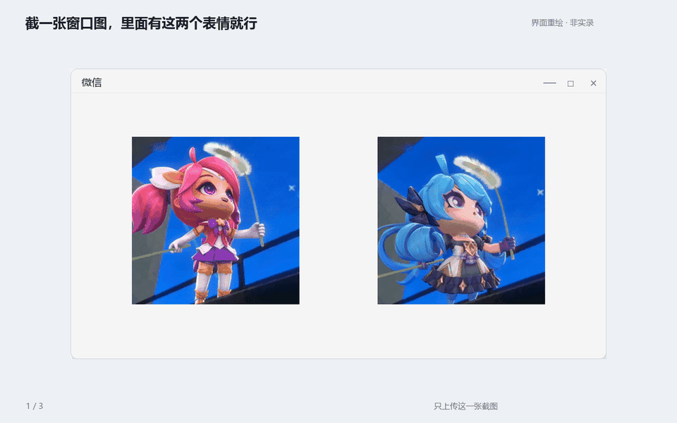

<div align="center">

# WeChat Sticker Extract

**微信表情提取 · 一张截图，保存你想要的动图。**

[](LICENSE)


[开始使用](#开始使用) · [操作教程](docs/GUIDE.md) · [18 秒演示](docs/assets/workflow-demo.mp4) · [报告问题](https://github.com/beemines/wechat-sticker-extract/issues)

</div>



<sub>演示界面为重绘示意，非实际录屏；角色 GIF 用于展示操作流程。</sub>

## 简介

一个面向 **Windows 微信 4.x** 的 Codex Skill。从你授权访问的本地聊天中定位指定表情，获取原始附件，核验后保存到 `wechat_emoji/`。

- **截图定位**：上传一张包含目标表情的窗口截图，用自然语言说明要保存哪张。
- **保留原图**：校验附件 MD5 和全部动画帧，保留 GIF、WebP 或 APNG 的真实格式。
- **本地处理**：数据库仅在内存中解密，不保存完整明文聊天库，不输出密钥。

> 截图用于定位消息，不用于生成动画。提取时需要本机已登录、已授权访问的微信账号及可用的原始附件。

## 开始使用

### 1. 安装

在 Codex 中发送：

```text
帮我安装这个技能，并配置它的 Python 依赖：
https://github.com/beemines/wechat-sticker-extract
```

需要 **Windows、Python 3.11+ 和已登录的微信**。Python 的 SQLite 构建需支持 `deserialize`。依赖仅为 `cryptography`、`Pillow`、`zstandard`。

<details>
<summary>手动安装（PowerShell）</summary>

```powershell
$skillHome = if ($env:CODEX_HOME) {
    Join-Path $env:CODEX_HOME 'skills'
} else {
    Join-Path $env:USERPROFILE '.codex\skills'
}
$skillTarget = Join-Path $skillHome 'wechat-sticker-extract'
New-Item -ItemType Directory -Path $skillHome -Force | Out-Null

git clone https://github.com/beemines/wechat-sticker-extract.git $skillTarget
python -m pip install -r (Join-Path $skillTarget 'requirements.txt')
```

重新打开 Codex 会话以发现新技能。若已有同名目录，先检查现有版本，避免覆盖本地修改。

</details>

### 2. 上传一张截图

微信保持登录，上传[一张包含两个表情的窗口截图](docs/assets/window-shot.png)，然后说：

> 帮我获取这两个表情。

无需分别上传两张图片，也不用填写技能名或文件路径。账号、聊天或目标不明确时，Codex 会补充确认定位信息。

### 3. 获取动图

```text
wechat_emoji/
├── 03_魔法少女.gif
├── 04_蓝毛剪刀.gif
└── *.verification.json
```

GIF 是成品；JSON 是包含帧数、尺寸、时长和哈希的核验记录。

## 效果预览

| 魔法少女 | 蓝毛剪刀 |
| :---: | :---: |
|  |  |
| 240 × 240 · 64 帧 · 4.27 秒 | 240 × 240 · 64 帧 · 4.27 秒 |

## 支持范围

| 项目 | 当前状态 |
| :--- | :--- |
| Windows 微信 4.1.15.53 | 已完成真实环境的指定表情提取验证 |
| 普通表情消息，包括未收藏表情 | 支持按聊天、时间、分库和消息 ID 定位 |
| 合并转发聊天记录 | 通用 CLI 暂不支持，需另外解析附件 |
| 其他微信版本、失效资源 | 不保证可提取，详见[版本边界](references/extraction.md#版本与读取) |
| macOS / Linux 微信 | 不支持提取；已有文件可独立离线核验 |

只处理你有权访问的账号和消息。获取附件会请求对应的腾讯资源地址；不会上传聊天库，也不会自动发送消息或发布文件。

## 文档与开发

[详细教程与常见问题](docs/GUIDE.md) · [技术说明](references/extraction.md) · [演示素材](docs/DEMO.md) · [参与贡献](CONTRIBUTING.md) · [安全反馈](SECURITY.md)

```powershell
python .\scripts\extract_sticker.py --help
python .\scripts\test_extract_sticker.py
```

离线测试不读取真实微信账号、聊天或进程内存。它们不代表已验证所有微信版本或资源变体。

## 许可证

项目代码与文档采用 [MIT License](LICENSE)。内置组件的版权、来源和许可保留在 [vendor/NOTICE.md](scripts/vendor/NOTICE.md)；演示角色素材的权利归各自权利人，不在项目 MIT 授权范围内。
