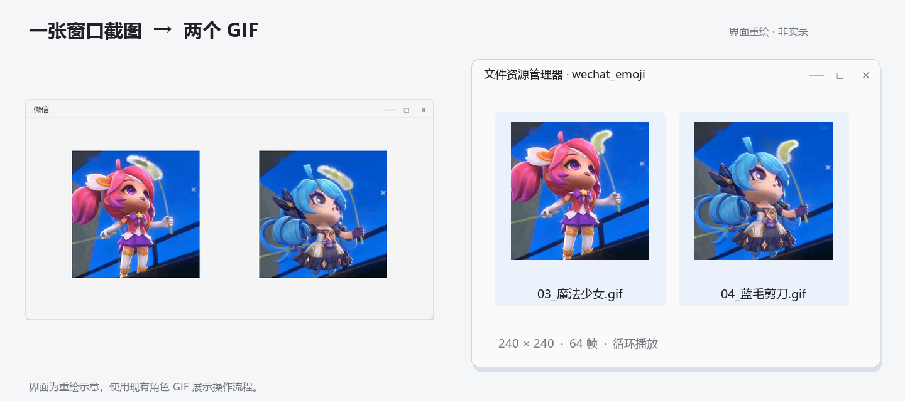

# 演示

[返回首页](../README.md) · [18 秒 MP4](assets/workflow-demo.mp4)

[](assets/workflow-demo.mp4)

三段操作，每段 6 秒：截一张包含两个表情的窗口图 → 上传这一张截图并说“帮我获取这两个表情” → 打开本地 GIF。没有开场、原理讲解或重复片尾。

界面为重绘示意，非实际录屏。两张 GIF 使用现有的魔法少女与蓝毛剪刀角色素材；账号、联系人、聊天文字与操作过程均为演示数据。表情素材的权利归各自权利人，不随项目 MIT 许可重新授权。

## 文件

| 文件 | 用途 |
| --- | --- |
| `workflow-demo.mp4` | 18 秒，1440×900，20 fps，无音轨 |
| `workflow-preview.gif` | 12.9 秒，960×600，README 动态预览 |
| `window-shot.png` | 唯一上传的截图，一张窗口图内包含两张角色图 |
| `demo-chat.png` | 截取单张窗口图 |
| `demo-request.png` | Codex 请求与结果 |
| `demo-result.png` | 文件夹与动图预览 |
| `magical-girl.gif` / `blue-scissors.gif` | 角色动图效果（64 帧，4.27 秒） |

## 重新生成

需要 Pillow、FFmpeg，以及中文字体。脚本只读取本目录的两张示例 GIF，不访问微信或网络：

```powershell
python .\scripts\build_demo.py --ffmpeg 'C:\工具\ffmpeg.exe'
```

FFmpeg 在 PATH 时可省略参数。用 `--font` / `--bold-font` 指定中文字体，`--qa-dir` 保存独立检查图。系统字体不包含在发布包里。

README 用 GIF 自动播放预览，视频通过 MP4 链接查看或下载。
