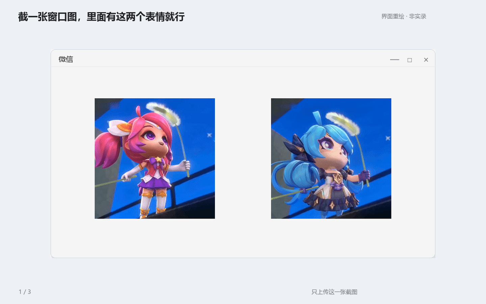
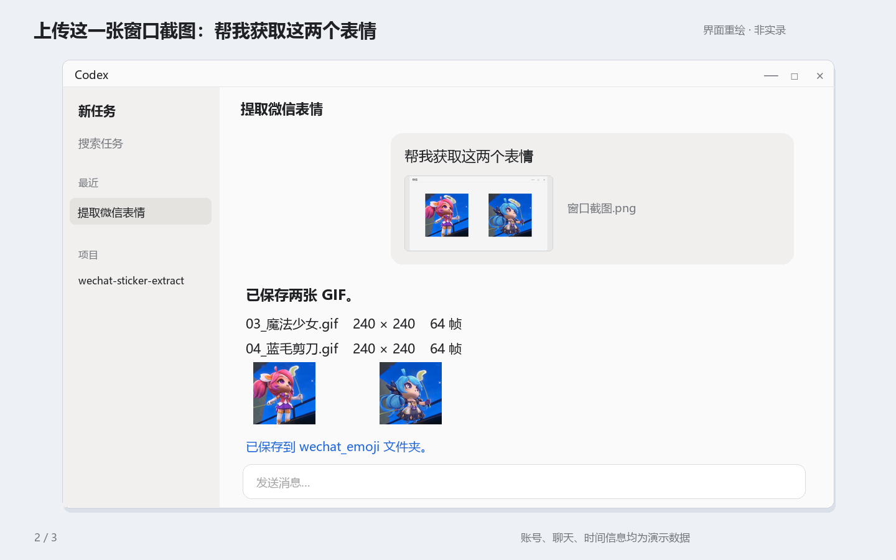
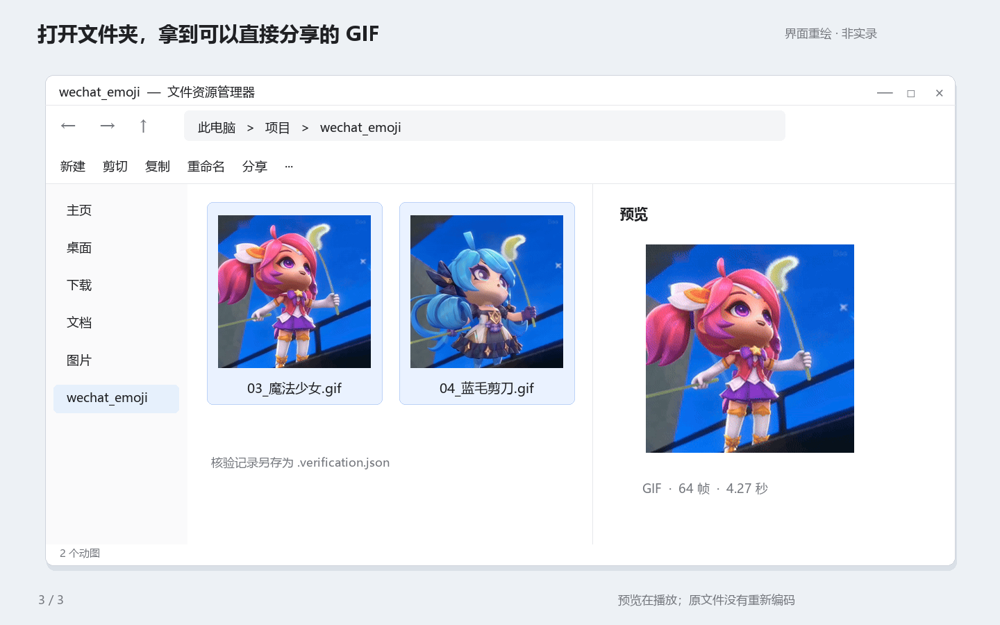

# 从微信消息提取原始表情：详细教程

[返回项目首页](../README.md) · [45 秒流程演示](assets/workflow-demo.mp4)

本教程中的界面为重绘示意，非实际录屏；两张演示表情使用现有的魔法少女与蓝毛剪刀 GIF。账号、联系人与界面操作为演示数据。

## 一、先判断你有什么

| 你手中的材料 | 下一步 |
| --- | --- |
| 微信聊天里的单张表情 | 指定账号、聊天与消息 |
| 一张聊天截图，原消息仍在本机 | 用截图定位原消息 |
| 只有静态截图，没有原消息或附件 | 无法从截图恢复原始动画 |
| 收藏失败、聊天仍能看到表情 | 检查对应消息附件，不必反复添加收藏 |
| 合并转发聊天里的表情 | 当前通用 CLI 不支持，需单独解析记录附件 |



## 二、准备 Python 与技能

在仓库根目录打开 PowerShell：

```powershell
python --version
python -m pip install -r .\requirements.txt
python .\scripts\extract_sticker.py --help
```

需要 Python 3.11+、SQLite 的 `deserialize` 方法，以及依赖清单中的三个包。不同 Python 安装的依赖互不一定可见，安装依赖时使用同一个 `python -m pip`。

使用 Codex 自然语言工作流时，按 [首页安装说明](../README.md#开始使用) 将仓库安装为技能。安装后上传一张包含这两个表情的窗口截图，说“帮我获取这两个表情”即可，不需要输入技能名或文件路径。直接使用 CLI 不要求安装到 Codex。

### 已有兼容依赖环境

不需要重复下载模型或构建大型运行环境。已有依赖可这样提供：

```powershell
python .\scripts\extract_sticker.py `
  --deps-dir 'D:\Python环境\Lib\site-packages' `
  list --account-dir $account --username filehelper
```

`--deps-dir` 放在子命令前。若其中含二进制扩展，保持 Python 次版本和位数兼容。

## 三、确定账号目录

打开微信，确认登录的是你授权提取的账号。在微信设置或已有本地配置中确认文件保存位置，账号目录应包含：

```text
wxid_你的账号/
└── db_storage/
    ├── contact/contact.db
    └── message/message_0.db
```

常见位置会随微信版本和用户迁移设置变化，不要直接照抄别人的路径。命令中的 `--account-dir` 指向 `wxid_…` 账号目录，而不是 `db_storage` 本身。

```powershell
$account = 'D:\微信文件\xwechat_files\wxid_你的账号'
$output = Join-Path (Get-Location).Path 'wechat_emoji'
```

账号目录只用于本地操作，不要提交到公共仓库。

## 四、列出限定范围内的候选

联系人名字默认精确匹配备注或昵称：

```powershell
python .\scripts\extract_sticker.py list `
  --account-dir $account --chat '演示联系人' `
  --after '2026-10-18T17:10:00+08:00' `
  --before '2026-10-18T17:13:00+08:00'
```

文件传输助手可以使用已知的 username，跳过联系人查询：

```powershell
python .\scripts\extract_sticker.py list `
  --account-dir $account --username filehelper `
  --message-db message_0.db `
  --after '2026-10-18T17:10:00+08:00' `
  --before '2026-10-18T17:13:00+08:00'
```

若必须按名字的一部分查询，加 `--contains`，且匹配结果必须唯一。时间需要包含时区，例如 `+08:00`。



列表包含分库、消息 ID、时间、MD5、附件尺寸等字段，不包含预览。**时间接近不等于视觉匹配**：多候选时需要返回授权聊天核对，或将少量候选输出到临时目录逐一比对。

## 五、固定目标并导出

假设列表确定目标在 `message_0.db`、本地 ID 为 `42`：

```powershell
$preview = Join-Path $env:TEMP 'wechat-sticker-preview'

python .\scripts\extract_sticker.py export `
  --account-dir $account --username filehelper `
  --message-db message_0.db --local-id 42 `
  --output-dir $output --name '收到' `
  --preview-dir $preview
```

- `--local-id` 必须配合 `--message-db`，不同分库可能有相同 ID。
- `--name` 只填写文件名主体；扩展名按实际资源格式生成。
- `--output-dir` 是 CLI 必填参数；技能默认选择当前工作目录的 `wechat_emoji`。
- `--preview-dir` 生成独立 PNG 预览，供视觉比对。
- 仅当你确实要求最新表情时使用 `--latest`。

也可以用附件 MD5 指定目标，但仍应保留准确时间范围。`--md5` 在 SQL 条数上限之后筛选，每个分库默认查询最新 32 条表情；较旧附件可能被条数限制排除。可用 `--limit` 提高至最多 200，或直接使用已知分库和消息 ID。

## 六、检查结果



成功导出需同时满足：

1. 文件内容 MD5 与消息附件一致。
2. 帧数大于 1，所有帧均可解码。
3. 实际格式可识别，尺寸、时长和循环信息可读取。
4. 查看预览，角色和文字与选定目标匹配。

脚本初始写入 `visual_match_checked: false`，因为结构校验不能代替人的视觉比对。

已有文件可离线核验，不访问微信。MD5 请使用消息中的原始校验值：

```powershell
python .\scripts\extract_sticker.py verify `
  --file '.\wechat_emoji\收到.gif' `
  --md5 '请替换为真实的32位附件MD5'
```

每个表情都有独立 MD5，不要把其他文件的校验值套用到当前表情。

## 常见问题

### 为什么 GIF 只是一张图？

可能拿到缩略图、静态封面，或查看软件没有播放动画。本脚本会拒绝只有一帧的资源，不会把缩略图当原始动图交付。检查 `frames` 是否大于 1，再使用支持 GIF 的软件打开。

### 添加到表情失败，还能提取吗？

如果对应消息仍保存着有效原资源信息，可以尝试附件路线。收藏列表不包含所有收到的表情；无法保证每一条失效资源都能恢复。

### 提示找不到数据库密钥怎么办？

确认微信正在运行、账号正确、读取权限允许、版本在已适配范围。使用环境正常的审批机制；不要关闭防护或把所有账号都扫描一遍。未知版本需要验证具体布局，不能只修改版本号宣称支持。

### 旧表情没有查到？

先确认聊天和时间范围，再确认分库。MD5 查询还受每分库候选条数限制；有确切消息 ID 时优先使用它。合并转发记录属于另一种消息结构，当前 CLI 不会在普通表情列表里列出它们。

### 能把输出后缀强制设成 GIF 吗？

不能靠改后缀转换格式。WebP / APNG 原文件会保留真实格式。需要 GIF 时，应另行转码并说明它是转换后的文件。

### 能不通过 Codex 使用吗？

可以。`list`、`export`、`verify` 均为本地命令。提取阶段需要 Windows 和受支持、已登录的微信；`verify` 只需文件与正确 MD5。

### 会保存完整聊天数据库吗？

不会。读取的是选定账号的相关数据库内存快照，导出的是目标表情与不含密钥的核验记录。网络请求只用于获取对应附件资源。

## 提交问题时

请说明 Windows / 微信 / Python 版本、执行的子命令，以及已脱敏的错误类别。不要上传账号数据库、真实聊天正文、数据库密钥、附件 AES key 或带签名下载地址。
